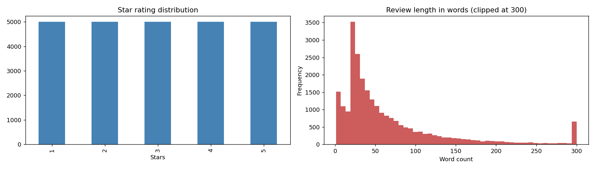
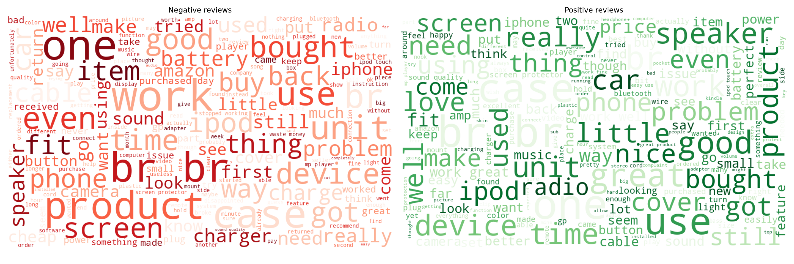
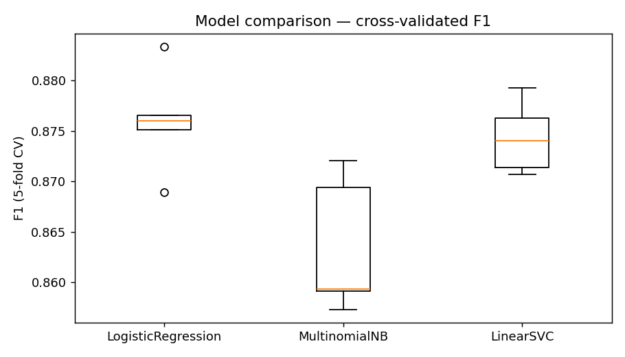
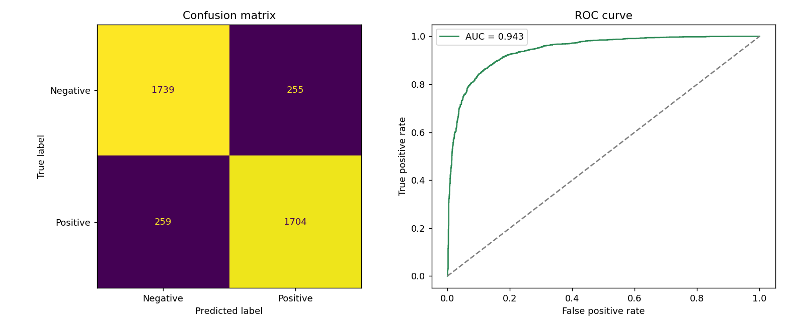
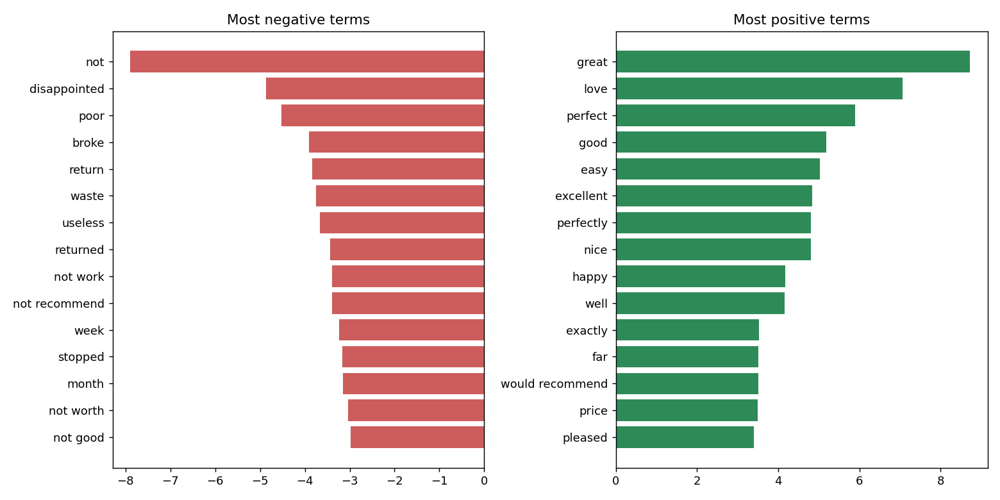
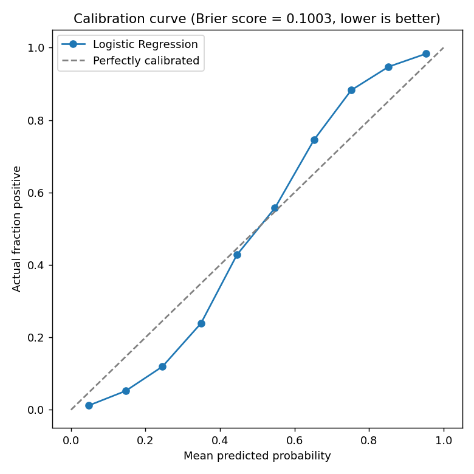
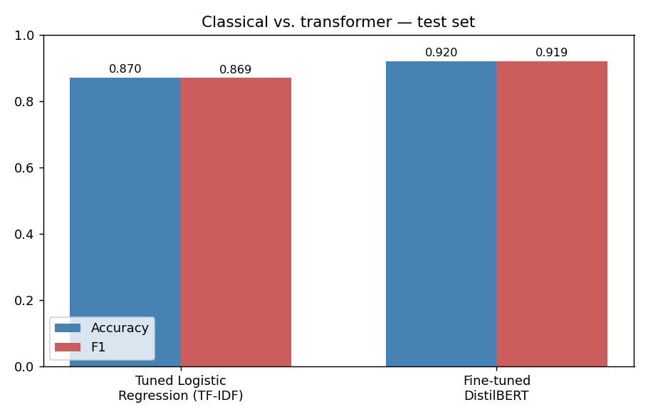

# Amazon Product Reviews Sentiment Analysis

In this project I classify the sentiment of 25,000 Amazon product reviews, first as positive vs. negative and then as a 3-class problem (negative, neutral, positive). I wanted to see how a carefully tuned classical pipeline (TF-IDF + Logistic Regression) compares with a fine-tuned DistilBERT model when both are trained and tested on exactly the same split.

## The data

- 25,000 reviews, split evenly across the 1-5 star ratings (5,000 per rating).
- Two columns: `Review` (the text) and `Sentiment` (the star rating, 1 to 5).
- The CSV is included in this repo (`Amazon-Product-Reviews-Sentiment-Analysis-in-Python-Dataset.csv`). The notebook reads it from a Kaggle path, so change the path at the top to point at the file next to the notebook.

## How I approached it

1. **Cleaning.** I dropped null rows and 255 exact duplicates. For the binary task I also dropped the 3-star reviews, since they are honestly ambiguous and I didn't want to force them into a class. Reviews with 4-5 stars became positive and 1-2 stars became negative, which left 19,784 reviews at roughly 50/50.

   

2. **Text preprocessing.** I lowercased the text, stripped everything that isn't a letter, lemmatized, and removed stopwords. I deliberately kept the negation words (`not`, `no`, `nor`, `never`), because removing them turns "not good" into "good" and flips the meaning.

   

3. **Splitting before vectorizing.** The `TfidfVectorizer` sits inside a scikit-learn `Pipeline`, so it is only ever fit on the training portion. That keeps test text out of the vectorizer in the cross-validation and in the grid search.

4. **Picking a model.** I compared Logistic Regression, Multinomial Naive Bayes and Linear SVC with 5-fold stratified cross-validation, using F1 as the score.

   

5. **Tuning.** I ran one grid search over the vectorizer and model settings together (`max_features`, `ngram_range`, `C`), because they affect each other.

6. **Evaluating.** On the held-out test set I looked at the full classification report, ROC-AUC, the confusion matrix and the most predictive terms from the model coefficients. I also checked calibration with the Brier score, to see whether the confidence values can be trusted.

   

   

   

7. **Comparing with DistilBERT.** I fine-tuned DistilBERT for 2 epochs on the same train/test split and evaluated it on the same test set, so the two approaches can be compared directly.

   

8. **Extension: three classes.** In a separate run I kept the 3-star reviews as their own neutral class, to measure what the ambiguity actually costs instead of assuming it.

## Results

| Model | Accuracy | F1 | ROC-AUC |
|---|---|---|---|
| Tuned Logistic Regression (TF-IDF) | 0.87 | 0.874 | 0.943 |
| Fine-tuned DistilBERT | 0.92 | 0.919 | - |

- The best classical settings were `C=1`, `max_features=8000` and `ngram_range=(1,2)`.
- Logistic Regression's predicted probabilities turned out reasonably calibrated (Brier score about 0.10), so I didn't need `CalibratedClassifierCV`. Look at the calibration plot yourself rather than taking my word for it. I did not check calibration for DistilBERT, and transformer confidence scores are often overconfident.
- In the 3-class run the macro F1 was about 0.63. Almost all of the drop comes from the neutral class (F1 about 0.40), which is hard to separate from both the positive and the negative side. That comes from the data, not from a bug in the pipeline.

## What's in the repo

```
amazon-sentiment-analysis.ipynb   # the whole pipeline: EDA, cleaning, classical models, DistilBERT, evaluation
01_rating_length_distribution.png ... 07_classical_vs_transformer.png   # the plots shown above
```

## Requirements

For the classical part:

```
pandas
numpy
matplotlib
seaborn
wordcloud
nltk
scikit-learn
```

The DistilBERT part needs a GPU runtime (for example Google Colab or Kaggle):

```
torch
transformers
datasets
accelerate
evaluate
```

## Trying the classical model

The `predict_sentiment` function is defined in the notebook. Run the notebook up to that cell, then:

```python
predict_sentiment("This product broke after two days, complete waste of money.")
# -> ('Negative', 0.991)
```

## Notes and limitations

- Both models use the same train/test split, but DistilBERT trains on the raw review text while the classical pipeline uses the cleaned, lemmatized text. Transformer tokenizers handle subwords themselves, so cleaning the text first would work against them.
- 3-star reviews are left out of the binary task on purpose. The 3-class run is the alternative.
- I haven't run a calibration check on DistilBERT's output probabilities.
